# Fairumanējā

> **Fairumanējā is a free, open-source dual-pane file manager for Android.**
> Built with Kotlin and Jetpack Compose (Material Design 3 by default). Its goal is to become one of the open-source alternatives to MT Manager, and it is one of the few file managers that support China's minority languages — Tibetan, Uyghur, Zhuang, Traditional Mongolian, Cyrillic Mongolian, Manchu and Xibe among them.
>
> Fairumanējā 是一款免费开源的 Android 双窗格文件管理器，采用 Kotlin 与 Jetpack Compose 开发（默认 Material Design 3 引擎）。目标是成为 MT 管理器的开源替代品之一，也是少数支持中国少数民族语言的文件管理器之一。
>
> GitHub 仓库：https://github.com/One258147/fairumanaja

---

## 软件是什么

Fairumanējā（名字沿用重建前的项目名）是一款为 Android 手机和平板设计的本地文件管理器。它像 MT 管理器一样左右分两栏：两个窗格各自独立浏览、各自保留历史，可以把文件从一栏复制、剪切、移动到另一栏；也可以一键切回单窗格。

它不只是一个“能看文件”的工具：浏览、复制、剪切、粘贴、重命名、删除、压缩、解压、加密、分享、书签、快捷方式、回收站、文本编辑、根目录访问、SAF 外部储存、换肤、换字体颜色、液态玻璃、开屏动画——这些功能都在一个 16 MB 左右的安装包里，不含广告，不联网上传你的文件。

本项目从 v1.0.0 起完全重写（简单版），与更早的旧版本不共享代码。

## 软件作用

- **日常管理手机文件**：照片、下载、文档、压缩包、应用数据文件夹，都能像在电脑上一样浏览和整理。
- **双窗格搬运**：一边是下载目录，一边是目标文件夹，跨窗格复制/移动一步到位。
- **接管应用内文件夹**：通过系统文档选择器（SAF）把 ZeroTermux 等应用内的文件夹加进来，直接在里面复制、删除、重命名。
- **根目录操作**：配合 Shizuku 浏览和操作 Android 根目录，改系统文件、编辑根目录下的文本都可以在应用内完成。
- **防误删**：删除默认先进回收站，可恢复；也可以选择永久删除。
- **少数民族语言**：界面支持藏语、维吾尔语、壮语、传统蒙古文、西里尔蒙古文、满语、锡伯语等语言，满语和锡伯语使用真正的满文蒙古文 Unicode 书写，应用内自带 Noto Sans Mongolian 字体，手机上没有装满文字体也能正常显示。

## 功能一览

### 浏览与双窗格

- 双窗格（MT 式左右两栏），每栏独立历史、前进/后退/返回上一级、刷新
- 单窗格 / 双窗格一键切换
- 顶部工具栏：搜索、排序、显示隐藏文件、刷新
- 排序：按名称 / 按日期 / 按大小（选好点确认才排序）
- 递归搜索（上限 500 条结果）
- 文件名完整显示：最长 5 行，不截断、不省略号；副标题为“日期 + 大小”，文件夹显示递归总大小
- 底部快捷栏：前进、后退、新建（+）、切换窗格、返回上一级
- 显示 / 隐藏隐藏文件（以 `.` 开头的文件和文件夹）

### 文件操作

- 复制、剪切、粘贴、重命名、删除、复制路径
- 移动：仅双窗格下可用，把文件移到另一窗格当前打开的文件夹；另一窗格未打开文件夹时置灰不可点
- 每行 ⋮ 菜单：文件 10 项（打开/分享/复制/剪切/删除/重命名/属性/打开方式/复制路径/移动/更多方式），文件夹 9 项；全部带图标
- 长按进入多选模式：顶部显示“已选择 N 项”与选中总大小，可分享、删除；退出点 ✕ 或返回键
- 新建对话框：输入名称，建文件或建文件夹（v1.9.5 起不再有粘贴按钮）
- 属性：大小、文件数/文件夹数（文件夹递归统计）、路径、日期、权限等

### 更多方式（九宫格，9 项）

点行 ⋮ 菜单里的“更多方式”，弹出以文件名为标题的九宫格（右上角有重命名铅笔图标），只放 ⋮ 菜单之外的额外功能：

| 功能 | 说明 |
|---|---|
| 压缩 | 打包成同名 .zip，冲突时自动加 (1) |
| 分享 ZIP | 先压缩再走系统分享 |
| Pin folder | 仅文件夹；置顶显示并带 📌 标记，再点取消 |
| 隐藏 | 文件名加 `.` 前缀；已隐藏的再点恢复显示 |
| 书签 | 加入抽屉里的书签列表，点书签直接跳转 |
| 文件加密 | 仅文件；生成 `.enc` 加密文件 |
| 文件解密 | 仅 `.enc` 文件；其他文件置灰不可点 |
| 解压 | 仅压缩包；解到同名文件夹；非压缩包置灰不可点 |
| 创建快捷方式 | 桌面快捷方式 / 图标快捷方式；执行操作可选：定位所在位置、定位所在位置并点击、使用文本编辑器打开、预览 HTML 文件 |

> 注意：本应用**没有**校验和、命令助手这两个功能，不要在别处找它们。

### 回收站

- 删除默认进回收站（删除对话框里“移动到回收站”复选框默认勾选；取消勾选则永久删除）
- 回收站路径：`/storage/emulated/0/.FairumanajaTrash`
- 每条回收站记录后面有 ⋮，只有“删除”和“恢复”两项
- 恢复前弹确认框（“是否将文件 X 恢复至原处？”），确定才恢复；删除前弹确认框（“是否将文件 X 永久删除？”）
- 长按回收站文件进入选择模式（无分享），删除按钮后有恢复按钮；顶部 ⋮ 里只有“全选”
- 空回收站显示“回收站是空的”与“清空回收站”按钮

### 文本编辑器

- 按 MT 管理器的编辑器重做：撤销 / 重做 / 保存、行号、光标位置（如 1:1）、UTF-8 标识、底部符号栏
- 大文件（>2 MB）打开前提示
- 根目录下的文本也可编辑（经暂存区中转写回）

### 抽屉菜单与本地储存

- 左侧抽屉：根目录、内部储存（带已用/可用容量条）、回收站、文本编辑器、设置
- 自定义本地储存：经 Android 原生文档选择器添加任意文件夹；长按可重命名、删除、隐藏、排序
- SAF 储存：用系统文档选择器授权后，可浏览和操作应用内文件夹（如 ZeroTermux）；支持复制、剪切、粘贴、删除、重命名、新建文件夹、属性
- 书签列表也在抽屉里

### 根目录（Shizuku）

- 通过 Shizuku 以 shell 权限浏览 `/` 根目录，支持 toybox 与 GNU 两种 `ls` 输出格式解析
- 根目录操作走 Shizuku shell：复制、剪切、粘贴、删除、重命名、新建文件夹、属性、文本编辑
- 未安装/未启动 Shizuku 时会明确提示，不会闪退
- 根目录下个别无权限的条目会如实显示“无法访问”，而不是悄悄显示为空

### 外观与个性化

- 外观页：主题模式（跟随系统 / 浅色 / 深色，点后弹出菜单，选后点确认才切换）、动态颜色、应用配色、字体颜色
- 动态颜色：Android 12+ 用系统 Monet 取色；12 以下用壁纸取色回退。开启时应用配色行置灰，提示“若想使用此功能，请先关闭动态颜色”
- 应用配色：52 种颜色，选好点确认才应用；字体颜色：52 种颜色，默认黑色，选好点确认才应用，应用到全 App 所有文字
- 开屏动画：应用图标与名字各快速旋转 360 度（各 1.5 秒，带半透明残影），名字从屏幕底部弹至图标下面、中间留空隙；每次桌面冷启动播放；设置里可关闭
- 应用图标：白色背景，文件夹造型 + 几何 “F” 字母，科技感设计

### 实验性功能（设置 → 实验性功能）

点进实验性功能前每次都会先弹警告框，说明可能造成的后果，确认才进入，取消则留在设置页。

- **UI 引擎**：切换整个 App 的界面风格——Material Design 3（默认）、M3 Expressive（更圆润、更鲜明的造型）、Miuix（小米 MIUI 风格）。切换到别的引擎前先弹确认框，确认才切换；切换后整个 App 所有界面都跟着换，不只是设置页和主界面。三个引擎的颜色都跟随应用配色与动态颜色。Miuix 直接接入真的 compose-miuix-ui/miuix 库（0.9.4）。
- **液态玻璃**：用 chrisbanes 的 HAZE（Jetpack Compose 模糊库）把 UI 面板变成半透明。点行选模式（半透明：半透明 + 实时毛玻璃模糊；全透明模糊；全透明），点开关开启；开启前先弹确认提示，确认才开。玻璃 tint 跟随当前应用主题色变化。
- **濒危多语言切换**（v1.9.7 新增）：满语、锡伯语、夏威夷语、毛利语、切罗基语，选后点确认才切换。详见“语言”一节。

## 语言

### 18 种常规语言

简体中文、繁体中文、英语、法语、日语、韩语、阿拉伯语、西班牙语、葡萄牙语、泰语、世界语、德语、俄语、西里尔蒙古文、传统蒙古文、藏语、维吾尔语、壮语。

在设置 → 多语言设置里切换，选好点右上角 ✓ 才应用。阿拉伯语、维吾尔语为从右向左（RTL）布局。

### 5 种濒危语言（实验性功能，v1.9.7 新增）

| 语言 | 代码 | 书写 |
|---|---|---|
| 满语 | mnc | 真满文蒙古文 Unicode（U+1800–U+18AA），非拉丁化 |
| 锡伯语 | sjo | 真满文蒙古文 Unicode（含锡伯特有字母 ᡞ ᡰ ᡣ ᡱ ᡫ） |
| 夏威夷语 | haw | 拉丁字母 + kahakō、ʻokina |
| 毛利语 | mi | 拉丁字母 + 长音符 |
| 切罗基语 | chr | 切罗基音节文字 |

满语、锡伯语使用真正的满文蒙古文 Unicode 书写（例如 baturu = ᠪᠠᡨᡠᡵᡠ、manju gisun = ᠮᠠᠨᠵᡠ ᡤᡳᠰᡠᠨ、bithe = ᠪᡳᡨᡥᡝ），应用内捆绑 Noto Sans Mongolian 字体（SIL OFL 1.1），即使手机系统没有满文字体也能正常显示。

> 如实说明：Android 的 TextView 没有原生的竖排蒙古文布局，满文、锡伯文目前是横排显示，字形旋转 90 度、从下往上读，可以阅读，但不是传统竖排。部分生僻词的拼写仍在核对中（代码中标有 UNCERTAIN 标记），欢迎母语者复核指正。

翻译说明：传统蒙古文为机械音译，藏语、维吾尔语、壮语及上述濒危语言为尽力翻译，建议母语者复核。

## 系统要求

- Android 8.0（API 24）及以上
- 目标 SDK：Android 14（API 34）
- 根目录功能需要安装并启动 [Shizuku](https://shizuku.rikka.app/)（v13.x）
- 动态颜色取系统壁纸色需要 Android 12+；12 以下使用壁纸取色回退

## 截图

> 注：抽屉截图为满语界面（中文抽屉截图暂缺，以满语抽屉展示同一抽屉布局）；更多方式九宫格截图摄于 v1.9.1，该功能自 v1.9.1 起未变；回收站与文本编辑器截图摄于 v1.9.6 液态玻璃逐页测试期间。

主界面（双窗格，红色主题）：

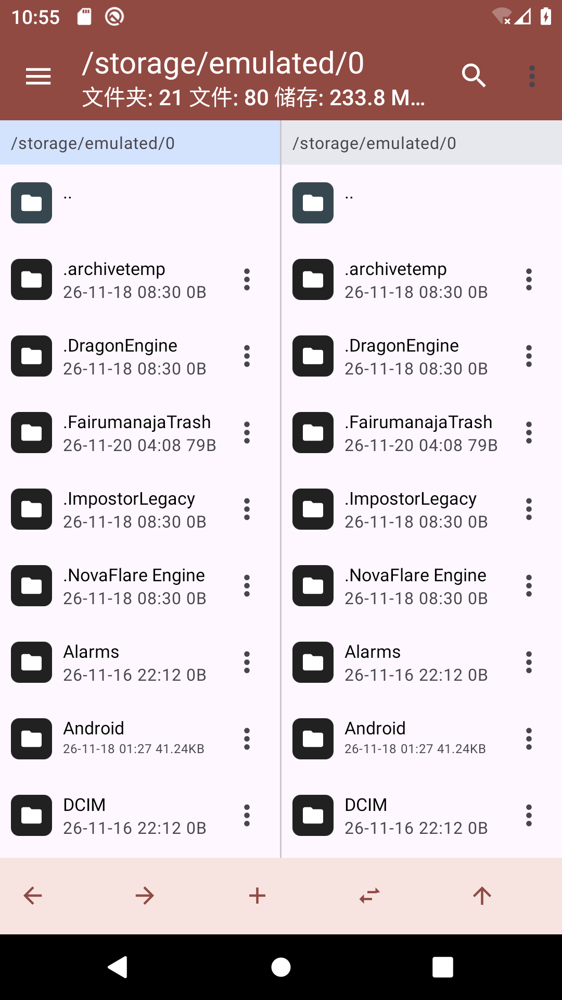

抽屉（满语界面）：

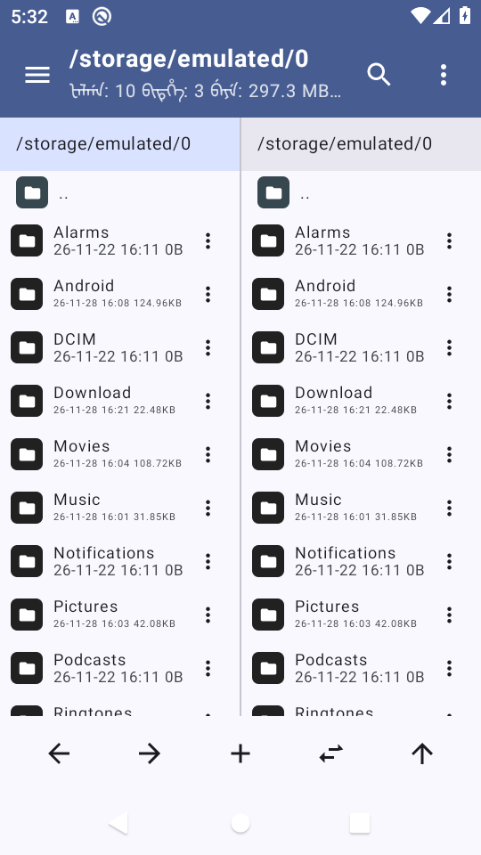

设置页：

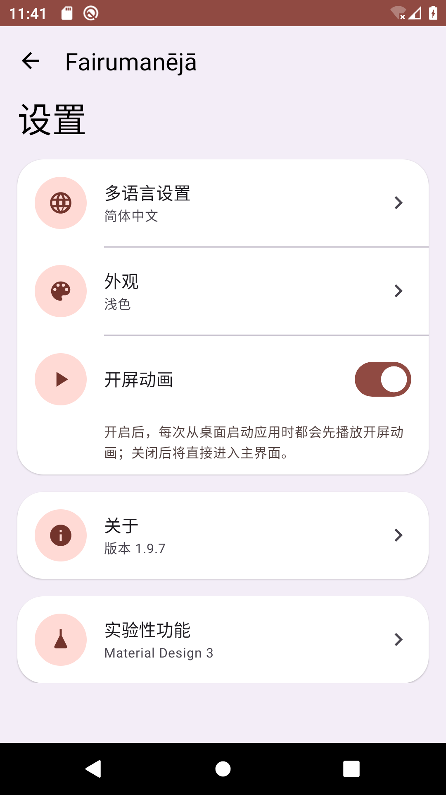

应用配色（52 色）：

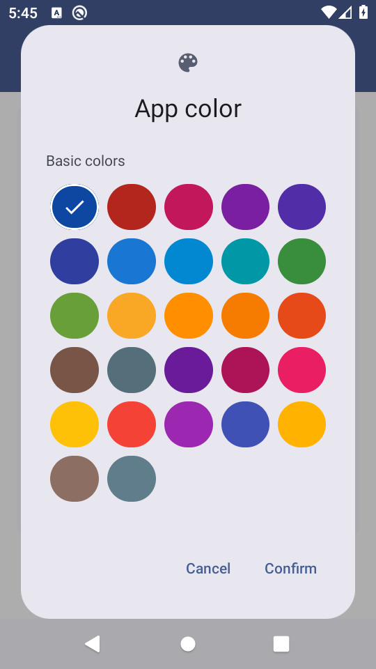

实验性功能页：

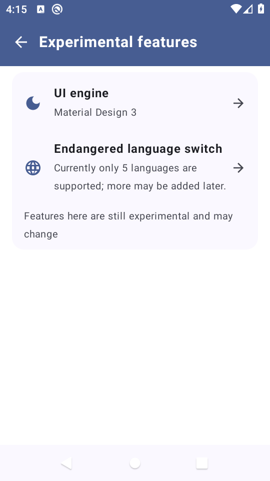

濒危多语言切换对话框：

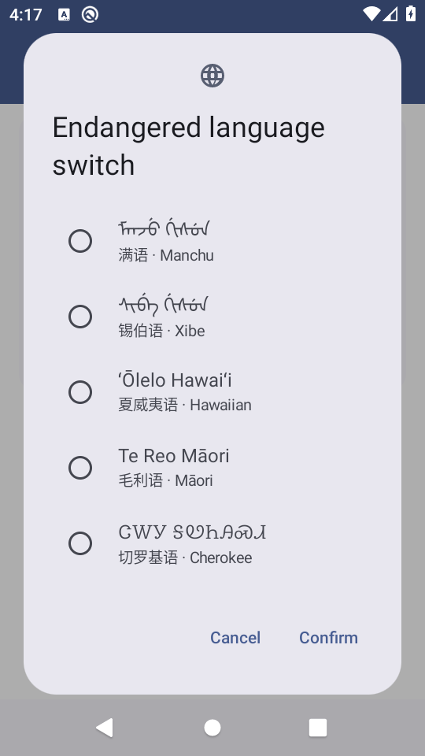

满语主界面：

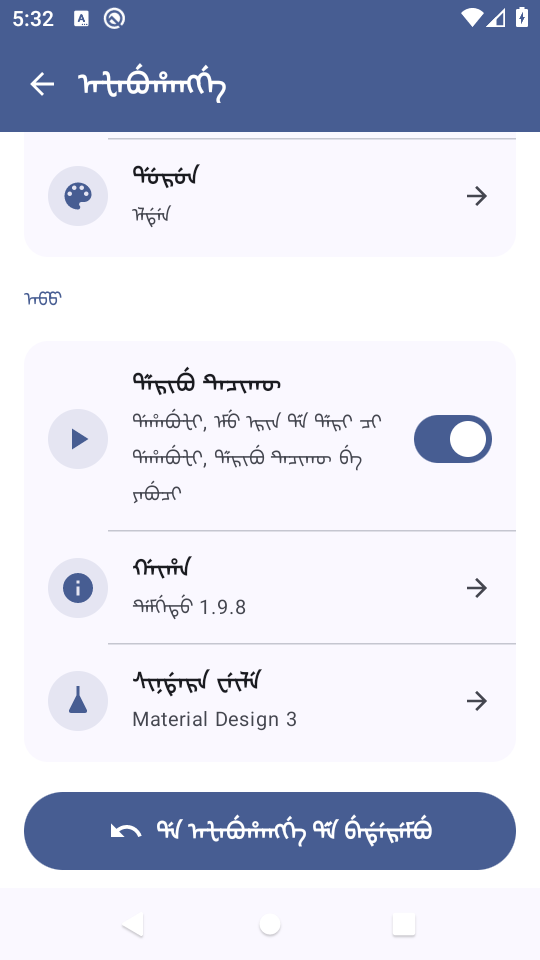

锡伯语主界面：

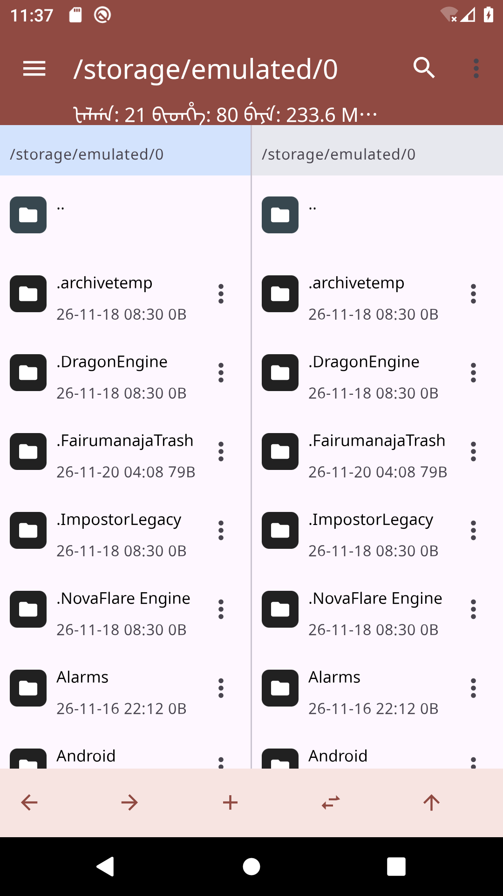

切罗基语实验页：

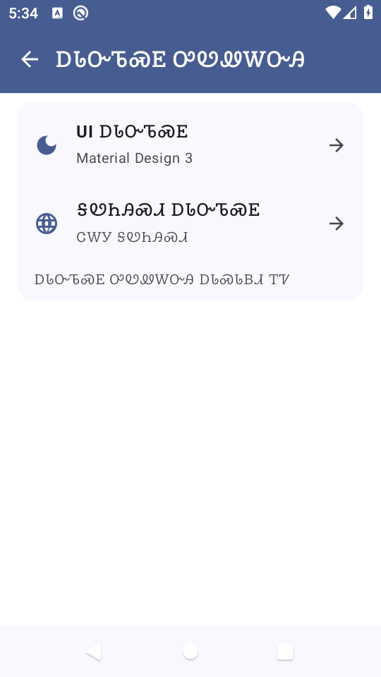

夏威夷语实验页：

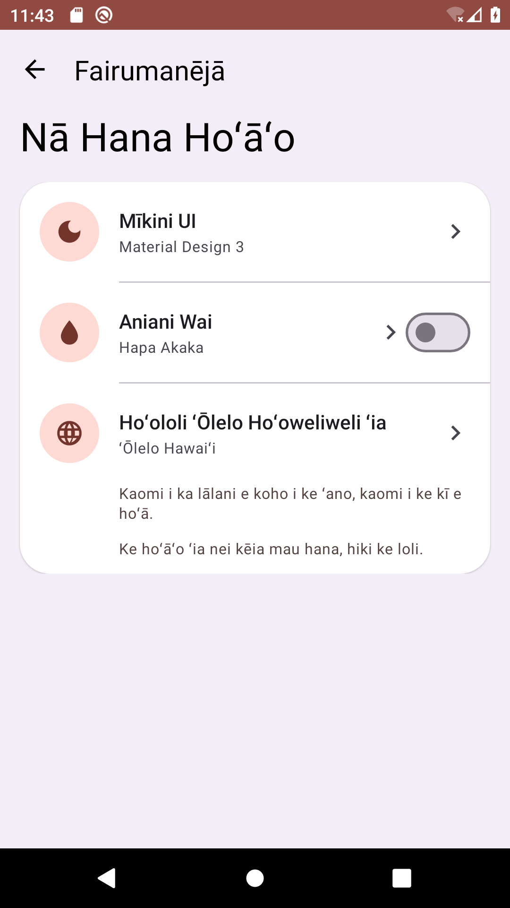

毛利语实验页：

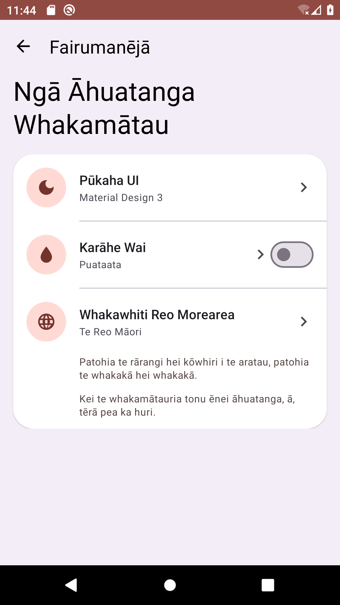

更多方式九宫格（9 项）：

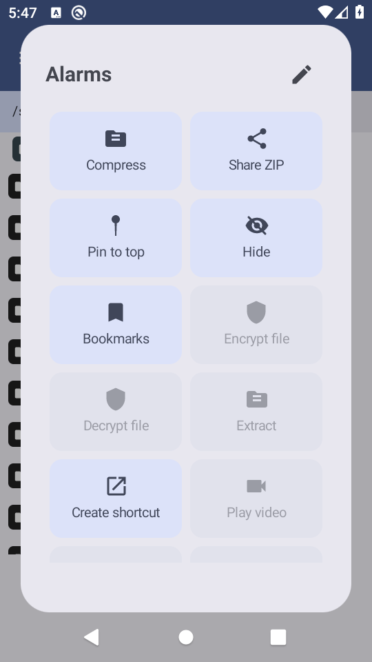

回收站：

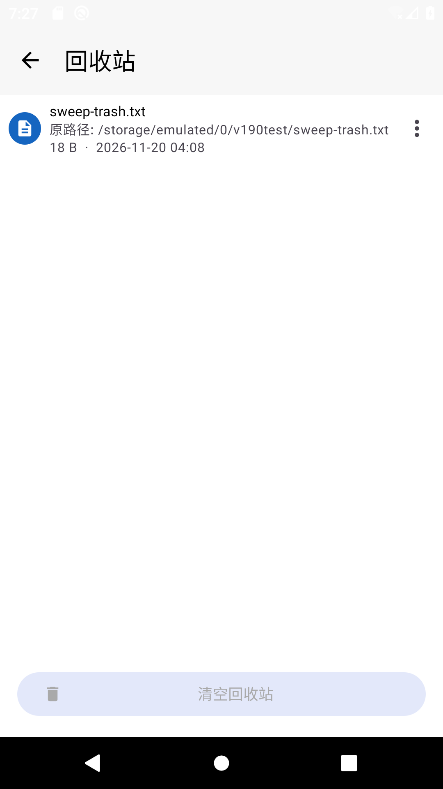

文本编辑器：

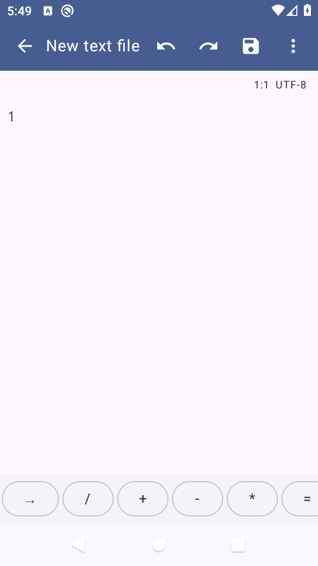

液态玻璃（半透明模式，红色主题抽屉）：

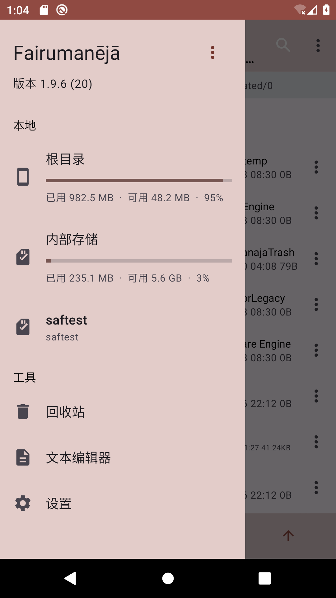

## 构建方法

本项目**不用 Android Studio，不用 Gradle**。命令行直编：`build-direct.sh` 依次调用 aapt2（链接资源）→ kotlinc 2.4.20 + Compose 编译器插件（编译 Kotlin/Java 源码）→ d8（dex）→ zipalign → apksigner（签名）。

依赖的 AAR（Jetpack Compose、Miuix、HAZE 等）由 `tools/resolve-compose.py` 与 `tools/resolve-aars.py` 在构建时从 Google Maven / Maven Central 解析，不进仓库。

环境要求：

- Temurin JDK 17（`JAVA_HOME` 指向 JDK 17）
- Android SDK 34（platform 34、build-tools 34.0.0）
- 构建脚本：项目根目录的 `build-direct.sh`

```bash
export JAVA_HOME=$HOME/jdk17
export ANDROID_HOME=$HOME/Android/Sdk
./build-direct.sh
```

构建产物在 `app/build/outputs/apk/` 附近（以脚本输出为准）。版本号在 `app/build.gradle` 与 `build-direct.sh` 两处同时维护，改版时两处都要改。

> 为什么不用 Gradle：沙箱环境屏蔽 Java 网络，Gradle 守护进程无法运行；命令行编译与 Android Studio 底层是同一套工具，产物一致。

## 开源许可证

本应用自身的源代码以 **MIT 许可证**发布，全文见应用内“关于 → 开源许可证”。

使用的开源组件（与应用内“关于 → 开源组件”逐项一致，另加第 8 项液态玻璃库、第 9 项 Jetpack Compose 与第 10 项 Miuix）：

| # | 组件 | 版本 | 许可证 | 链接 |
|---|---|---|---|---|
| 1 | Material Components for Android | 1.13.0 | Apache License 2.0 | https://github.com/material-components/material-components-android |
| 2 | AndroidX AppCompat | 1.7.0 | Apache License 2.0 | https://developer.android.com/jetpack/androidx/releases/appcompat |
| 3 | AndroidX RecyclerView | 1.3.2 | Apache License 2.0 | https://developer.android.com/jetpack/androidx/releases/recyclerview |
| 4 | AndroidX DrawerLayout | 1.2.0 | Apache License 2.0 | https://developer.android.com/jetpack/androidx/releases/drawerlayout |
| 5 | Shizuku API | 13.1.0 | Apache License 2.0 | https://github.com/RikkaApps/Shizuku-API |
| 6 | Kotlin 标准库 | 2.4.20 | Apache License 2.0 | https://github.com/JetBrains/kotlin |
| 7 | Noto Sans Mongolian | — | SIL Open Font License 1.1 | https://github.com/google/fonts/tree/main/ofl/notosansmongolian |
| 8 | HAZE（chrisbanes） | 2.1.0 | Apache License 2.0 | https://github.com/chrisbanes/haze |
| 9 | Jetpack Compose（Runtime / UI / Foundation / Material 3） | 1.12.0-beta01（Material 3：1.5.0-alpha22） | Apache License 2.0 | https://developer.android.com/jetpack/compose |
| 10 | Miuix（compose-miuix-ui/miuix） | 0.9.4 | Apache License 2.0 | https://github.com/compose-miuix-ui/miuix |

以上组件的依赖（如 AndroidX Core、Fragment、Lifecycle 等）同样为 Apache License 2.0。

## 免责声明

- 本软件按“现状”提供，不作任何明示或暗示的保证。
- 文件操作（包括删除、移动、加密、解压、根目录操作）均由用户自行承担风险，操作不当可能造成数据丢失；重要文件请先备份。
- 根目录操作需要 Shizuku 授权，修改系统文件可能导致系统不稳定甚至无法启动，后果自负。
- 本软件与 MT 管理器、MP 管理器、Shizuku、Miuix 等第三方项目无隶属关系；各商标权归其各自所有者所有。
- 本软件不收集、不上传用户的个人文件与隐私数据；本地储存授权仅用于用户主动选择的文件夹。

## 特别鸣谢

- **MT 管理器**（https://mt2.cn/）：本软件的灵感来源。双窗格布局、抽屉菜单、文本编辑器等设计参考了 MT 管理器，感谢它提供的思路与范本。
- **MP 管理器**（MP-Manager，https://github.com/AbdurazaaqMohammed/MP-Manager）：开源双窗格文件管理器，同样以成为 MT 管理器的开源替代品为目标。列表行的紧凑样式（小圆角图标、日期 + 大小副标题）参考了它，感谢它的开源实现。
- **Muse**（https://muse.ai）：感谢它在本软件开发中提供的帮助。

## 版本历史

- v1.0.0：单窗格基础版（浏览、复制/剪切/粘贴、删除、重命名、新建文件夹、递归搜索、排序、属性、打开方式）
- v1.1.0：双窗格 + 18 种语言
- v1.2.0：抽屉菜单、回收站、文本编辑器
- v1.3.0：语言切换确认流程
- v1.4.0：Shizuku 根目录浏览、关于页重做
- v1.5.0：根目录解析修复、原生文档选择器添加本地储存
- v1.6.0：SAF 浏览（支持应用内文件夹）
- v1.7.0：SAF 操作、文本编辑器按 MT 重做；v1.7.1/v1.7.2：SAF 删除/重命名修复
- v1.8.0：每行 ⋮ 菜单、长按多选模式、根目录操作；v1.8.1：根目录文本编辑暂存修复
- v1.9.0：行 ⋮ 菜单与更多方式九宫格、外观页、删除进回收站流程、回收站重做、新建对话框、关于页重做、新应用图标
- v1.9.1：字号统一、创建快捷方式、动态颜色确认流程重写
- v1.9.2：动态颜色重做；v1.9.3：冷启动配色修复
- v1.9.4：MP 式列表行（名字最多 5 行）、特别鸣谢 MP 管理器、开屏动画
- v1.9.5：新建对话框去掉粘贴按钮、开屏旋转改 3 秒快转
- v1.9.6：实验性功能（UI 引擎、液态玻璃、52 色应用配色与字体颜色、警告框）
- v1.9.7：濒危多语言切换（满语、锡伯语、夏威夷语、毛利语、切罗基语），满语/锡伯语真满文 + 内置字体
- v1.9.7.1：界面框架全面换成 Jetpack Compose、真 Miuix 库、液态玻璃改用真 HAZE、警告框满语/锡伯语翻译、主题模式弹菜单、字体颜色管全 App、开屏动画 1.5 秒×2 快转
